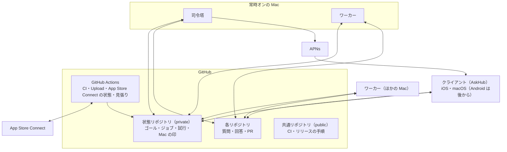

# 構成

## 全体

- クライアントと司令塔・ワーカーは直接つながらない。やり取りはすべて GitHub を通す
- 人が見るもの（質問・回答・PR・Discussion）は、今までどおり各リポジトリに置く
- 機械の状態は状態リポジトリに置く。各 Mac のファイルは作業場所とキャッシュだけにし、消えても状態リポジトリから戻せるようにする
- 外出先からも同じ情報を見られることと、新しいサービスを増やさないことを優先して、状態の置き場所を GitHub にした

## 構成要素

| 構成要素 | 役割 |
| --- | --- |
| クライアント | 人が操作する唯一の場所。GitHub から状態を読んで表示し、署名した人の意図を書く。判断や処理はしない |
| 状態リポジトリ | 機械の状態の正本。epic ごとのゴール・進み具合、ジョブと試行、Mac ごとの生きている印、端末の宛先（通知）を、構造化したファイルで持つ |
| 共通リポジトリ | CI・リリースのワークフローと道具の正本。各リポジトリは版を指定して呼ぶ（[operations.md](operations.md)） |
| GitHub Actions | CI・Upload・App Store Connect の状態の読み取り・司令塔の見張り。macOS のランナーが要るのは CI と Upload だけ |
| 司令塔 | 決めて配る。GitHub と状態リポジトリを見張り、ジョブを作って担当の Mac を決める。常時オンの Mac で済むジョブは自分で実行する |
| ワーカー | 実行する。自分に割り当てられたジョブを取り、実行して結果を書く |

## Mac の種類と役割

| Mac | 動くもの | 起動のしかた |
| --- | --- | --- |
| 常時オンの Mac | 司令塔とワーカー | ログイン中のセッションの LaunchAgent として常駐 |
| 常駐できる Mac | ワーカー | ログイン中のセッションの LaunchAgent として常駐。開いている間だけ動く |
| 常駐できない Mac | ワーカー | ターミナルのコマンドで起動し、再起動やログアウトまで動き続ける |

- 「担当 PC」の考え方はやめる。リポジトリを Mac に割り当てず、仕事を epic 単位で割り当てる
- リポジトリごとに「回してよい Mac」を設定する仕組みは持たない。Mac は開始のときに人が選ぶ（「おまかせ」で司令塔が選ぶ機能を足すときに、選び方の決まりを改めて考える）
- epic の実装は、開始のときに人が選んだ Mac に固定する。司令塔が勝手にほかの Mac へ移すことはない。ほかの Mac への引き継ぎは人が選ぶ（[operations.md](operations.md)）
- 質問づくり・説明・着手前の確認・最終 PR の対処・App Store Connect の状態・通知は、常時オンの Mac で行う
  - 最終 PR のコードを変える対処を、epic の Mac がオンラインならその Mac で行うかは、実装の段階で決める。段階 0 で、今の仕組みの CI の自動修正が、常時オンの Mac で最初からビルドし直して 60 分の上限に収まらず失敗していたことが分かったので、epic の Mac（作業場所と DerivedData が温まっている）で行う案を有力にする
- 司令塔とワーカーは、ssh から起動しない。ssh のセッションからは Keychain を読めないため（段階 0 で確認）

## Claude の契約

- Claude の契約（サブスクリプション）は、Mac ごとに 1 つだけ使う。ワーカーがリポジトリごとに契約を切り替えることはしない
- 無人の実行には `claude setup-token` で作ったトークン（1 年有効）を使う。値は Keychain に置く（[security.md](security.md)）
- 環境に API キーなどの別の認証があると、そちらが優先されて従量課金になる。Claude を起動するときは認証に関わる変数をすべて消し、その Mac の契約の 1 つだけを渡す
- ワーカーの登録で、貼られた値の先頭を確かめる（setup-token は `sk-ant-oat01-`、API キーは `sk-ant-api03-` の想定）。サブスクリプションの欄に API キーが貼られたら止めて知らせる
- 利用上限は契約ごとに来る。同じ契約の Mac どうしと、人の対話での利用とで枠を共有するので、上限の待ちは契約の単位で扱う
- 司令塔の仕事（人が待っている説明など）は、実装のループより先に枠を使えるようにする

## 対象のリポジトリと clone

- リポジトリは AskHub で「対象に加える」だけにする。加えるときに行うのは、GitHub 側の準備と、設定を状態リポジトリに書くことだけで、どの Mac にも clone しない
- clone は、ジョブが要るときにその Mac でだけ、ワーカー専用のフォルダに作る（必要になるまで中身を取らない partial clone）
- epic の作業場所（worktree・Simulator・DerivedData）は、最終 PR のマージ後に消す。clone 本体は、最後に使ってから 7 日で消す。空き容量が少なければ早めに消す
- 人が自分で置いている clone には触れない

## ジョブと試行

すべての仕事（質問づくり・説明・着手前の確認・タスクの実装・CI の再実行・最終 PR の修正・審査への提出・片付け・通知など）を、ジョブという 1 つの型で扱う。ジョブを 1 回実行することを試行と呼ぶ。

| 項目 | ジョブ | 試行 |
| --- | --- | --- |
| 持つもの | 種類・対象（リポジトリ・epic・タスク）・状態・担当の Mac・依存・試行の一覧 | 開始と終了の時刻・実行した Mac・結果・失敗の区分・短い説明・ログの抜粋・次の予定 |
| 置き場所 | 状態リポジトリ | 状態リポジトリ |

- 再試行・諦める・人に渡す、の決まりは、ジョブの種類と失敗の区分ごとの表で決める。種類ごとに別の仕組みを作らない
- 司令塔やワーカーを再起動しても、状態リポジトリから続きを再開する
- ジョブは並んで動く。守るのは Mac ごとの上限（Claude を同時にいくつ・ビルドを同時にいくつ）だけで、長い仕事がほかを止めない
- ログの抜粋は、トークンらしい文字列を伏せてから書く

### 二重処理を防ぐ

push や PR の作成をした後、それを記録する前にワーカーが落ちても、やり直しで二重に作らないようにする。

- 実行の前に「試します」の印を書く
- push は `--force-with-lease` で行う
- やり直す前に、すでにできているかを外部の id（PR の番号・ブランチの先頭など）で確かめる
- ジョブには貸し出しの期限を持たせ、期限が切れたものだけを取り直す

### 失敗の区分と既定の扱い

| 区分 | 例 | 既定の扱い |
| --- | --- | --- |
| ランナー不足 | CI が始まらない・ランナーが割り当てられないまま終わる | 間隔を広げて上限なしで再試行（10 分から始め、最大 1 時間）。人の対応は要らない |
| 揺らぎ | 流し直すと通る | 1 回だけ流し直す。通ったら記録する |
| ビルド・テストの失敗 | — | Claude に直させる（3 回まで）→ 人へ |
| レビューの必須の指摘 | — | Claude に直させる（3 回まで）→ 人へ |
| コンフリクト | — | Claude に解消させる（3 回まで）→ 人へ |
| 利用上限 | Claude の 5 時間・週の枠 | 解除の時刻まで待って再開する |
| 認証切れ | Claude や GitHub のトークン | すぐ人へ。直るまで、同じ認証を使うジョブを止める |
| 時間切れ | 実行時間の上限を超えた | 読み取りの失敗と分けて記録する。重いジョブは上限と実行する Mac を見直し、続くなら人へ |
| GitHub の障害 | 5xx の応答・空の一覧 | 待って再試行する。空の結果をもとに何かを作り直さない |
| Mac がオフライン | 閉じた・再起動した | 一時停止し、戻ったら再開する。スリープや通信断による中断は失敗に数えない |
| 想定外 | 上のどれでもない | すぐ人へ（ログの抜粋つき） |

人に渡すときは、何が起きて何を試したかと、その場で選べる操作（さらに直させる・自分で見る・やめる など）をクライアントに出す。黙って止まらない。

## 司令塔とワーカーの分担

| | 司令塔 | ワーカー |
| --- | --- | --- |
| 役割 | 決めて配る | 実行する |
| すること | GitHub と状態リポジトリを見張り、ジョブを作って担当の Mac を決める。常時オンの Mac で済むジョブを自分で実行する | 割り当てられたジョブを取り、実行して結果を書く。生きている印を書く |
| やり取り | 状態リポジトリを通す | 状態リポジトリを通す |

- 処理はすべて Swift で書く。シェルスクリプトには処理を書かず、テストできる形にする
- Claude を呼ぶ部品は 1 つにする（下の「ワーカーが Claude を呼ぶとき」）

### ワーカーの中身

ワーカーは、画面の無いコマンドラインのプログラム 1 つ（仮に `askhub-worker`）。どの Mac でも中身は同じ。

| 部品 | すること |
| --- | --- |
| ジョブの受け取り | 状態リポジトリから自分宛てのジョブを取る。生きている印（オンラインか・空き容量・負荷・版・起動したときの自己診断の結果）を書く |
| 確認 | ジョブの元になった人の意図の署名を確かめる |
| 作業場所の用意 | ワーカー専用のフォルダに clone・worktree・DerivedData を用意し、決まった名前の Simulator を用意する |
| Claude を呼ぶ | タスクの指示を渡して `claude -p` を起動し、決まった形の報告を受け取る |
| ビルドとテスト | Claude に頼まれたら、決まったコマンドで `xcodebuild`・`simctl` を sandbox の外で流して結果を返す。Claude Code の sandbox の中では、Simulator のサービスにつながらず、パッケージの解決も拒まれて、Xcode のビルドとテストが動かない（段階 0 で確認） |
| GitHub の操作 | commit・push・子 PR・CI の待ち・マージ。GitHub のトークンはワーカーだけが持つ。Claude には git のコマンドを許可しない（sandbox の中でも commit でき、worktree では共有の `.git` にも書けるため） |
| 記録と片付け | 試行の結果を状態リポジトリに書く。epic が終わったら作業場所を消す |

### ワーカーが Claude を呼ぶとき

- ralph-loop（Stop hook・完了語・playbook の読み直し）は使わない。ワーカーがタスクを 1 つずつ渡し、終わったかどうかはワーカーがタスクの一覧で判断する
- 1 回の呼び出しの中で、Claude はファイルを読む・書く・ビルドする・テストを流すといった操作を何度でも行える。CI が落ちたときは、同じ会話を再開（`--resume`）して失敗のログを渡す
- Claude は途中で人に聞かない。判断が要るときは「質問が必要」と報告して終わり、ワーカーが質問をクライアントに出す
- 呼び出しの決まり:
  - ワーカー専用の設定フォルダ（`CLAUDE_CONFIG_DIR`）で動かし、人の `~/.claude` の指示・hook・プラグインを効かせない
  - 権限は `dontAsk`（許可の一覧にある操作だけ通し、ほかは自動で断る）と sandbox。`bypassPermissions` は使わない
  - `--restricted --strict-mcp-config` で起動し、設定は `--settings` で渡すものだけにする。通常の起動では、リポジトリの `.claude/settings.json` の hooks と環境変数、`.mcp.json` のサーバー、CLAUDE.md がすべて効くことを段階 0 で確認した（[security.md](security.md)）
  - `--restricted` では CLAUDE.md も読まれないので、リポジトリの事実（CLAUDE.md の全員向けの事実）は、ワーカーが system prompt に足して渡す
  - 標準入力は `/dev/null` にする（渡さないと 3 秒待つ）
  - 結果は JSON Schema で形を決めて受け取る（完了 / 質問が必要 / 仮決めの一覧（見える・内部の区分つき）/ 見つけた知見）
  - モデルはジョブの種類ごとに `--model` で指定し、実際に使われたモデルを試行に記録する。違えば止める。指定しないと、既定のモデルは認証の方式やアカウントで変わる（段階 0 では、setup-token の認証で Sonnet 5.5 になった）
  - Claude Code の版は固定し、1 台で試してから広げる
  - 実行時間の上限はワーカーが測り、超えたら SIGINT、待っても終わらなければ SIGTERM で止める
- ワーカー向けの規則は、ワーカーの中のタスクの指示の雛形に持つ。各リポジトリの CLAUDE.md には、そのリポジトリだけの事実を書く
- ループに役立つ知見は「ワーカー向けの知見」として別に持って渡す。ループが新しい知見を見つけたら、知見を足す PR として出し、人がマージしたものだけを取り込む

## 状態リポジトリの書き方

GitHub の上限（同じアカウントで REST は 1 時間 5,000 件、内容を作る要求は 1 分 80 件・1 時間 500 件）を、クライアント・司令塔・全ワーカー・Actions で分け合う。書き込みの量を最初から設計に入れる。

- 書き手ごとにファイルを分ける。Mac の印はその Mac だけ、試行は実行したワーカーだけ、割り当ては司令塔だけが書く
- 書き手ごとに、1 時間あたりの書き込みの予算を決める
- 生きている印は、変化があったときと、一定の間隔（10 分程度）でだけ書く
- 同時の書き込みは、GitHub の版（sha）を確かめて防ぐ。ぶつかったら読み直してやり直す
- 読むのは `git fetch` か、ETag つきの要求にする
- 二次の上限（ヘッダーの無い 403 など）を、権限のエラーと取り違えない
- 段階 0 では、今の仕組みが動いている間、同じアカウントの REST の上限の 3 割ほどがすでに使われていた。ETag つきの読み取り（304）は上限に数えられないとみられ、古い版を指定した書き込みは 409 で弾かれることを確かめた
- 終わった epic の記録は畳み、履歴が膨らみすぎないようにする

## 同じリポジトリの複数の epic

- 最初の版では、1 つのリポジトリで同時に回す epic は 1 本にする。状態・ジョブ・作業場所は epic ごとに分けておき、後から本数を増やせる作りにする（既定 2 本、リポジトリごとに変えられる形を予定）
- ほかの epic が develop に入ったら、走っている epic はタスクの区切りで develop を取り込み、コンフリクトはその epic のループが解消する

## 見張り

- 司令塔とワーカーは、生きている印に起動したときの自己診断（トークン・Keychain・空き容量）の結果も書く
- 司令塔そのものが止まると通知も止まるので、GitHub Actions の定期実行が司令塔の生きている印の古さを確かめる。古ければ github-actions[bot] が Issue を立てる（bot の書き込みなので GitHub の通知が届く）
- クライアントは、「取得に失敗した」と「対応が必要なものは 0 件」を必ず分けて表示する

## プラットフォームとプロトコル

- ワーカーのビルド・テスト、CI、テストの配布、リリースは、プラットフォームごとに差し替えられる部品にする。最初は Apple だけを実装し、Android は境目だけを決めておく
- プロトコル（状態リポジトリのファイル・各リポジトリに書く目印・人の意図の署名）は、言語に依存しない形（JSON Schema と、入力と出力のテスト用の例）で定義する。目印は 1 つの書式にそろえ、版の番号を付ける
- クライアントは Swift と Kotlin で別々に作り、共通のコードは持たない。同じテスト用の例を両方のテストで読み、同じ結果になることを確かめる
