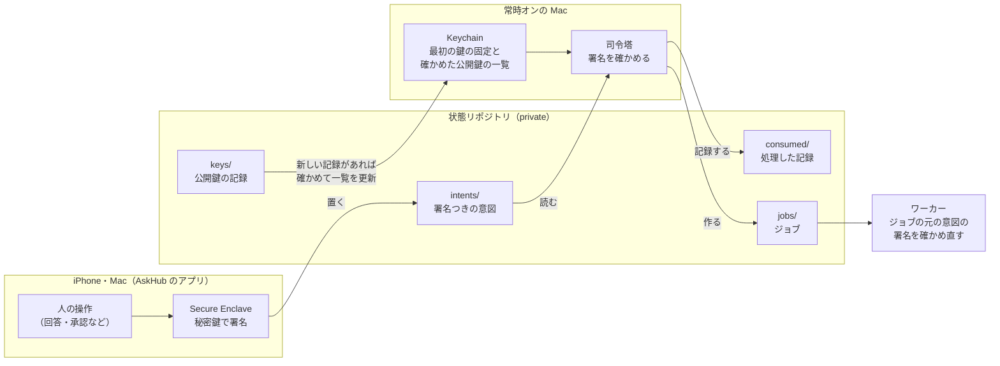
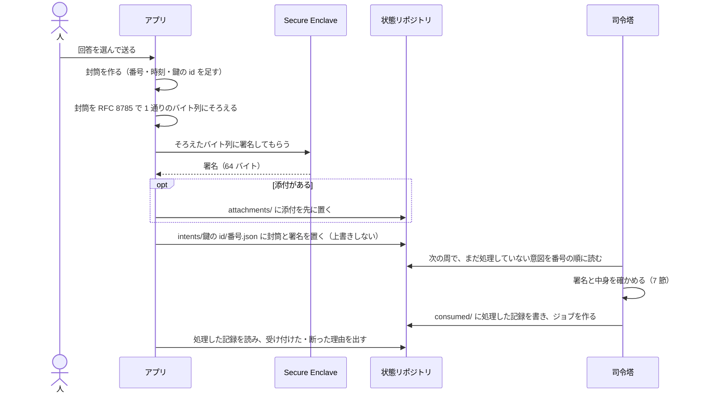
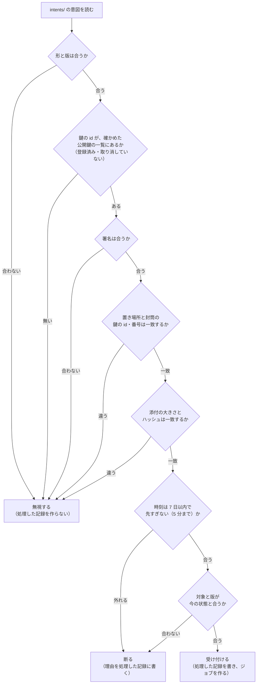
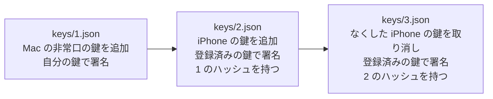
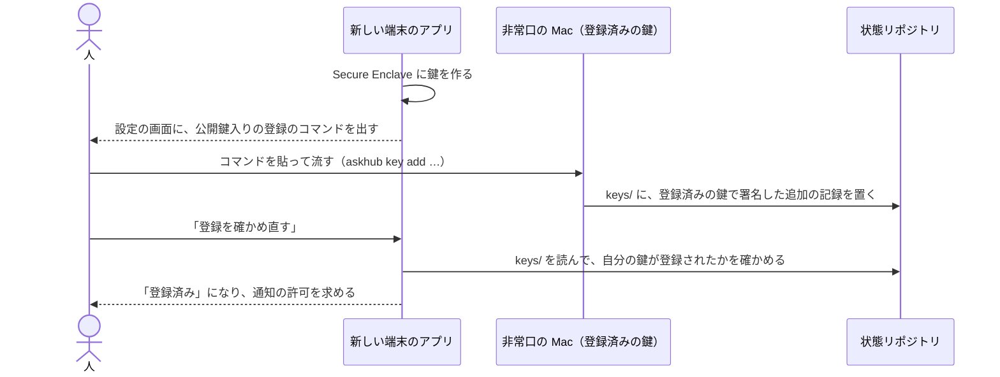

# 人の意図の署名のしくみ（解説）

AskHub のアプリから依頼・回答・マージの承認などを送ったとき、司令塔とワーカーが「本当に本人が送ったものか」をどう確かめているかを、初めて読む人向けにまとめた解説。
決まりの正本は [security.md](security.md)（方針）と [protocol.md](protocol.md)（形式）で、この文書はそれを図とたとえで読み解くためのもの。食い違ったら正本に従う。

## 1. ひとことで言うと

- アプリは、**その端末の中にしか無い秘密鍵**で、送る中身に署名してから状態リポジトリに置く
- 司令塔とワーカーは、**登録済みの公開鍵**で署名を確かめ、合ったものだけを指示として扱う
- 公開鍵の一覧そのものも「署名でつないだ追記だけの記録」にし、その起点（最初の鍵）を司令塔とワーカーに手で固定しておく

GitHub のアカウントやトークンではなく、「端末の中の秘密鍵を持っていること」を本人の証明にしている。

## 2. なぜ要るのか

AskHub では、人・司令塔・ワーカーが **同じ GitHub のアカウント** で書き込む（GitHub App や機械用のアカウントは使わない）。そのため、次の理由で「誰が書いたか」を GitHub だけでは見分けられない。

| 困ること | 例 |
| --- | --- |
| 人と機械を書き手で見分けられない | ワーカーが書いたコメントも、人が書いたコメントも、同じアカウントの書き込みに見える |
| public のリポジトリには誰でも書ける | 第三者が PR に「マージして」とコメントできる |
| 機械が誘導されて書くかもしれない | 作業中の Claude が、依頼のような文章を書いてしまう |
| トークンが漏れるかもしれない | 状態リポジトリに書けるトークンがあれば、意図のファイルを置ける |

そこで、**機械を動かす人の書き込み（人の意図）にだけ署名を付け、署名を確かめられたものだけを指示として扱う** ことにした。
各リポジトリの PR や Discussion のコメントは、同じアカウントのものでも指示として読まない（人が自分の Claude のセッションから PR にコメントしても、ループは動かない）。

人の意図にあたるもの: 依頼・回答・説明を求める・ゴールの修正・開始・最終 PR への指示・判断のカードへの答え・マージの承認・一時停止と再開・引き継ぎ・人がする作業の完了・リポジトリの登録と設定 など。鍵の登録と取り消しは、意図ではなく公開鍵の記録（8 節）で行う。

## 3. 登場するもの

ハンコと印鑑登録にたとえると分かりやすい。

| 名前 | たとえ | 中身 | 置き場所 |
| --- | --- | --- | --- |
| 秘密鍵 | 実印 | ECDSA P-256 の秘密鍵。端末ごとに 1 本 | 各端末の Secure Enclave。端末の外に出ない |
| 公開鍵 | 役所に届けた印影 | 秘密鍵と対になる鍵。署名を確かめるのに使う。知られても困らない | 状態リポジトリの `keys/` |
| 鍵の id | 印鑑登録の番号 | 公開鍵の SHA-256 を base64url にした 43 文字 | 封筒の `keyId`・ファイルのパス |
| 封筒（envelope） | 実印を押す申込書 | 「何を・どれに・いつ・どの鍵で」を書いた JSON | 状態リポジトリの `intents/<鍵の id>/<番号>.json` |
| 公開鍵の記録 | 印鑑登録簿 | 鍵の登録・取り消しを、追記だけで並べた記録の列 | 状態リポジトリの `keys/<連番>.json` |
| 最初の鍵の固定 | 登録簿の 1 ページ目の控え | 最初に登録した鍵の id | 司令塔とワーカーの Mac の Keychain |
| 処理した記録 | 使用済みの印 | 一度処理した意図の番号 | 状態リポジトリの `consumed/<鍵の id>/<番号>.json` |

## 4. 全体の流れ



- アプリと司令塔は直接つながらない。やり取りはすべて状態リポジトリを通す
- 司令塔とワーカーは、状態リポジトリの `keys/` をそのまま信用しない。手元の Keychain に固定した最初の鍵から、記録を順にたどって確かめた一覧だけを使う

## 5. 鍵ができるまで（端末ごと）

アプリ（と非常口のコマンド `askhub`）は、初めて使うときに端末ごとの鍵を作る（`DeviceSigningKey.loadOrCreate`）。

- **Secure Enclave に作る**: 秘密鍵は Secure Enclave の中で作られ、取り出せない。Keychain に置くのは「その端末の Secure Enclave でしか使えない形」だけなので、Keychain の中身を別の端末にコピーしても署名できない
- **使える条件は「その端末で、ロックが解除されている間」**: Face ID・Touch ID は求めない。Siri やショートカットなど、アプリの画面の外からも送れるようにするため（ユーザーの決定）
- **Secure Enclave の無い環境**（Simulator など）では、ソフトウェアの鍵になる。設定の画面の「この端末の鍵」の「保存場所」で見分けられる
- **方式は ECDSA P-256**: iPhone・Mac の Secure Enclave と、後から作る Android の Keystore の両方で、鍵を端末の外に出さずに扱える方式として選んだ

設定の画面の「この端末の鍵」に、鍵の id と登録の状態が出る。登録の手順は「[9. 端末を足す・なくす](#9-端末を足すなくす)」。

## 6. 送るときに何が起きるか

### 封筒の中身

たとえば、質問に「日ごと」と回答すると、次の封筒を作る。

```json
{
  "v": 1,
  "kind": "answer",
  "repo": "shilokuma-inc/prime-pick-ios",
  "target": { "type": "question", "epic": "01JC…", "id": "q1" },
  "targetVersion": "1",
  "payload": { "mode": "answer", "choice": "日ごと", "note": "" },
  "issuedAt": "2026-11-03T10:00:00Z",
  "nonce": "01JC…",
  "keyId": "…"
}
```

| 項目 | 意味 | 何を防ぐか |
| --- | --- | --- |
| `v` | 封筒の形の版 | 形が変わったときの読み違い |
| `kind` | 意図の種類（回答・開始・マージの承認 など） | 回答を承認として使い回すこと |
| `repo`・`target` | どのリポジトリの、どの質問・epic・PR への意図か | ほかの質問・ほかの PR への貼り替え |
| `targetVersion` | 人が見たときの対象の版（質問の版・ゴールの版・最終 PR の head のコミット など） | 古い画面を見て出した意図や、承認の後に変わった PR のマージ |
| `payload` | 中身（回答の選択肢・指示の本文・添付の名前と大きさとハッシュ など） | 中身の書き換え |
| `issuedAt` | 署名した時刻 | 古い意図の使い回し（7 日を過ぎたら断る） |
| `nonce` | 一度しか使えない番号（時刻の順に並ぶ ULID） | 同じ意図の二度使い |
| `keyId` | どの端末の鍵で署名したか | 確かめる公開鍵の取り違え |

封筒の **すべての項目** が署名の対象なので、1 文字でも変えると署名が合わなくなる。

### 送る手順



#### なぜ「そろえる」のか

JSON は、同じ中身でも項目の並びや空白の入れ方で、バイト列が変わる。署名はバイト列に対して行うので、書く側と確かめる側で並べ方がずれると、正しい意図でも署名が合わなくなる。
そこで、封筒を RFC 8785（JSON Canonicalization Scheme）という決まった並べ方にそろえてから署名する。Swift と後から作る Kotlin で同じ結果になることを、言語によらないテスト用の例（[`protocol/vectors/`](../../protocol/vectors)）で確かめている。

## 7. 司令塔が確かめること

司令塔は、`intents/` に置かれた意図を番号の順に 1 つずつ確かめる。



図は正本（[protocol.md](protocol.md) の「確かめること」と「処理した記録」）の決まりに沿った順。今のコードは時刻を置き場所・添付より先に確かめるので、期限切れの意図は置き場所や添付が合わなくても「断る」の記録を作る（[#1119](https://github.com/shilokuma-inc/ask-hub-apple/issues/1119) で正本に合わせる）。

- **受け付けた・断った意図は、`consumed/<鍵の id>/<番号>.json` に記録する**。新しく作るだけで上書きしないので、同じ番号は二度と処理しない。アプリはこの記録を読んで、送った意図が受け付けられたか・なぜ断られたかを出す
- **署名が合わない意図は、記録も作らずに無視する**。署名の合わない偽物の番号で記録を作ると、同じ番号を使う本物の意図を「処理済み」にして潰せてしまうため
- **鍵に結びついたアカウントも確かめる**: 公開鍵の記録の各鍵は GitHub のアカウントに結びついていて、司令塔のセットアップで決めた信用するアカウント（今は 1 つ）の鍵だけを一覧に入れる
- **ワーカーも確かめ直す**: ワーカーはジョブを引き受ける前に、ジョブの元になった人の意図（`origin`）を状態リポジトリから読み、自分の Keychain の一覧で署名を確かめる。元の意図が無い・署名が合わないジョブは実行しない（実行まで時間がかかることがあるので、ここでは 7 日の期限は見ない）
- **通知も登録済みの端末だけに送る**: 司令塔は、確かめた一覧にある鍵の端末にだけ通知を送る。取り消した端末には送らない

### マージの承認の例

最終 PR のマージの承認（`approveMerge`）は、`targetVersion` に「人が見たときの最終 PR の head のコミット」を入れて署名する。
承認した後にワーカーが修正を push すると head が変わるので、司令塔は「承認したものと違う」として断り、承認し直すまでマージしない。

## 8. 公開鍵の一覧の守り方

署名を確かめる側が持つ「公開鍵の一覧」が書き換えられると、偽の鍵で署名した意図も通ってしまう。そこで一覧そのものを、次のように守る。

### 追記だけの記録の列

公開鍵は `keys/1.json`・`keys/2.json`… と連番で、追記だけの記録として置く。



```json
{
  "v": 1,
  "seq": 2,
  "action": "add",
  "keyId": "…",
  "publicKey": "<公開鍵>",
  "account": "<GitHub のアカウント>",
  "label": "iPhone",
  "issuedAt": "2026-11-03T10:00:00Z",
  "previousSha256": "<keys/1.json のハッシュ>",
  "signedBy": "<登録済みの鍵の id>",
  "sig": "…"
}
```

- **1 件目は自分で署名する**。司令塔とワーカーは、セットアップのときにこの鍵の id を手で固定し（`--first-key`）、Keychain に置く。後から別の鍵には変えられない
- **2 件目からは、その時点で登録済みの鍵が署名する**。勝手に鍵を足すには、登録済みの端末の秘密鍵が要る
- **`previousSha256` で前の記録とつなぐ**。途中の記録を書き換える・抜くと、つながらなくなって見つかる
- 次の記録は受け付けず、そこから後ろを使わない: 連番の抜けや重なり・つながらない・署名した鍵が登録済みでない・登録済みの鍵の再登録・登録されていない鍵の取り消し・**最後の 1 本の取り消し**（人の意図を出せなくなるため）・信用しないアカウントの鍵

### 巻き戻しを見つける

司令塔とワーカーは、確かめた一覧を **自分の Keychain** に置き、「何件目まで確かめたか」と「最後の記録のハッシュ」も覚えておく。状態リポジトリの `keys/` は「新しい記録が増えたか」を見るためだけに使う。

- 記録が前より短くなった、または前に確かめた最後の記録が変わっていたら（取り消しの記録を消して、なくした端末の鍵を戻そうとした など）、一覧を変えずに止まって知らせる
- そのため、状態リポジトリの `keys/` を書き換えられても、司令塔とワーカーが信用する鍵は増えない

## 9. 端末を足す・なくす

### 最初のセットアップ

最初の鍵は、Mac の非常口のコマンド（`askhub`）で作る（[operations.md](operations.md) の「非常口」）。

1. `askhub setup --state-repo <owner/repo>`: その Mac に署名の鍵を作る
2. `askhub key register-first --account <GitHub のアカウント> --label <名前>`: この鍵を最初の鍵（`keys/1.json`）として登録し、鍵の id を表示する
3. 司令塔とワーカーのセットアップ（`askhub-commander setup`・`askhub-worker setup`）に、`--first-key <2 で出た鍵の id>` と `--key-account <GitHub のアカウント>` を渡して固定する

### iPhone・Mac のアプリを足す



- 登録されるまで、その端末から送った意図は指示として扱われない
- 今は、鍵の登録と取り消しを非常口のコマンドで行う（アプリの中で登録・取り消しする画面はまだ無い）

### 端末をなくした・盗まれた

- ほかの登録済みの端末（今は非常口の Mac）で `askhub key revoke <鍵の id>` を流し、取り消しの記録を足す
- 取り消した後は、その鍵で署名した意図を受け付けず、その端末に通知も送らない
- 秘密鍵は Secure Enclave の外に出ないので、端末を取り戻せない限り、鍵を盗むことはできない。ただし、ロックが解除された状態で端末を奪われると、取り消すまでの間は署名できる（下の「防げないこと」）

## 10. 何を防げるか

| やられそうなこと | 止める仕組み |
| --- | --- |
| public のリポジトリの PR や Discussion に「マージして」と書く | 指示として読むのは `intents/` の署名つきの意図だけ |
| 同じアカウントの Claude のセッションや作業中の Claude が、指示のような文章を書く | 秘密鍵を持っていないので署名できない |
| トークンを手に入れて、`intents/` に偽の意図を置く | 秘密鍵が無いので署名できない |
| `keys/` に偽の公開鍵を足す | 登録済みの鍵の署名が要る。起点の鍵は司令塔とワーカーに固定済み |
| `keys/` の取り消しの記録を消して、なくした端末の鍵を戻す | 確かめた件数と最後のハッシュと比べ、巻き戻しとして止まる |
| 回答の選択肢や指示の本文を書き換える | 封筒のすべての項目が署名の対象 |
| 依頼の添付を差し替える | 添付の大きさとハッシュを封筒に入れて署名し、司令塔が照合する |
| 前に出した意図をコピーして、もう一度置く | 番号は一度しか使えない（`consumed/`）。7 日を過ぎたものは断る |
| 古い質問への回答を、新しい版の質問に使う | `targetVersion` が今の版と違えば断る |
| マージを承認した後に変更を push して、そのままマージさせる | 承認は head のコミットに結びつくので、変わったら承認し直すまでマージしない |
| 意図のファイルを別の端末・番号の場所に動かす | 置き場所と封筒の鍵の id・番号が一致しなければ無視する |
| 偽の意図で番号を先に使い、本物の意図を潰す | 署名が合った意図だけを記録する |
| 人の意図に基づかないジョブを置いて、ワーカーに実行させる | ワーカーは、ジョブの元の意図の署名を確かめてから実行する |

## 11. 防げないこと・前提にしていること

- **ロックが解除された端末を奪われた**: ロック解除中は Face ID なしで署名できるので、取り消すまでの間は意図を出せる。気づいたら、ほかの端末からすぐに取り消す
- **状態リポジトリに書けるトークンが漏れた**: なりすましの指示は出せないが、ファイルを消す・機械が書くファイル（ジョブ・epic の状態など。署名していない）を書き換えるといった妨害はできる。状態リポジトリは private にし、トークンは Keychain だけに置き、権限を絞る（[security.md](security.md) の「トークン」）
- **司令塔・ワーカーの Mac の Keychain**: 最初の鍵の固定と確かめた一覧はここにある。Keychain の項目は、Developer ID で署名した司令塔とワーカーだけが読める設定にしている。見覚えの無い確認の画面が出たら拒否する
- **非常口の Mac**: 最初の鍵と、鍵の登録・取り消しを担う。Secure Enclave の無い Mac では、ソフトウェアの鍵になる
- **端末の時計**: 7 日の期限と「先すぎる時刻」の確認に使う。端末の時計が大きくずれていると断られる
- **共同開発者**: 今は信用するアカウントが 1 つだけ。鍵をアカウントに結びつけてあるので、後から足せる作りにしている（[security.md](security.md) の「共同開発者」）

## 12. 技術的な詳細の早見表

| 項目 | 値 |
| --- | --- |
| 署名の方式 | ECDSA P-256・SHA-256 |
| 署名するバイト列 | 封筒（公開鍵の記録では `sig` を除いた記録）を RFC 8785 でそろえた UTF-8 |
| 署名の形 | IEEE P1363（r と s を 32 バイトずつ、計 64 バイト）を base64url |
| 鍵の id | 公開鍵（SubjectPublicKeyInfo の DER）の SHA-256 を base64url（43 文字） |
| 一度しか使えない番号 | ULID（時刻の順に並ぶ。同じ端末から続けて送っても順が入れ替わらない） |
| 有効期間 | 署名から 7 日。先の時刻は 5 分まで許す |
| 鍵の置き場所 | Secure Enclave（ロック解除中・その端末だけ。生体認証なし） |
| 意図の置き場所 | `intents/<鍵の id>/<番号>.json`（`{"envelope": …, "sig": "…"}`） |
| 処理した記録 | `consumed/<鍵の id>/<番号>.json`（`accepted` か `rejected` と理由） |
| 公開鍵の記録 | `keys/<連番>.json`（追記だけ。`previousSha256` でつなぐ） |

## 13. コードの在りか

| 役割 | 場所 |
| --- | --- |
| 端末の鍵（Secure Enclave） | `AskHubKit/Sources/AskHubKeychain/DeviceSigningKey.swift` |
| 封筒と、署名・時刻の確認 | `AskHubKit/Sources/AskHubProtocol/Intent.swift`（`IntentEnvelope`・`IntentVerifier`） |
| 署名と鍵の id | `AskHubKit/Sources/AskHubProtocol/IntentSignature.swift` |
| JSON のそろえ方（RFC 8785） | `AskHubKit/Sources/AskHubProtocol/CanonicalJSON.swift` |
| 公開鍵の記録の確認 | `AskHubKit/Sources/AskHubProtocol/KeyLedger.swift` |
| 最初の鍵の固定と、確かめた一覧（Keychain） | `AskHubKit/Sources/AskHubKeychain/TrustAnchor.swift` |
| 意図を署名して置く（アプリ・非常口） | `AskHubKit/Sources/AskHubClient/IntentSender.swift` |
| 公開鍵の記録を足す（非常口） | `AskHubKit/Sources/AskHubClient/KeyLedgerWriter.swift` |
| 意図の受け付け（司令塔） | `AskHubKit/Sources/AskHubCommander/IntentIntake.swift`・`TrustedKeys.swift` |
| ジョブの元の意図の確認（ワーカー） | `AskHubKit/Sources/AskHubCommander/MachineJobs.swift`（`OriginCheckedRunner`） |
| アプリの登録の表示 | `AskHub/State/KeyRegistration.swift`・`AskHub/Screens/Settings/ConnectionSettingsSections.swift` |
| 言語によらないテスト用の例 | `protocol/vectors/intent-signature.json`・`stored-intent.json`・`key-ledger.json`・`canonical-json.json` |
